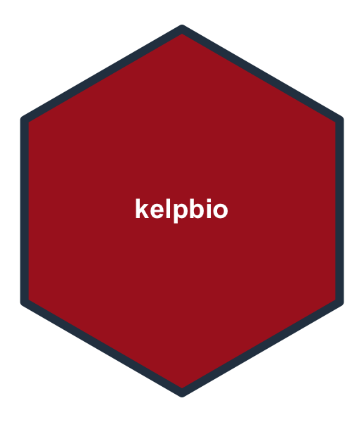

<!-- README.md is generated from README.Rmd. Please edit that file -->

```{r setup, include = FALSE}
knitr::opts_chunk$set(
  collapse = TRUE,
  comment = "#>",
  fig.path = "man/figures/README-",
  fig.width = 6,
  fig.height = 4
)
```

# kelpbio 

<!-- badges: start -->
[](https://github.com/HakaiInstitute/kelpbio/actions/workflows/R-CMD-check.yaml)
[](https://hakaiinstitute.r-universe.dev/kelpbio)
[](https://hakaiinstitute.r-universe.dev/kelpbio)
[](https://lifecycle.r-lib.org/articles/stages.html#experimental)
<!-- badges: end -->

kelpbio estimates the biomass and carbon of *Nereocystis luetkeana* and
*Macrocystis pyrifera* kelp beds with Bayesian hierarchical models. The total
biomass of a site in a year combines three sources:

- plants counted and measured by in situ surveys;
- the canopy area mapped from drone or other imagery;
- a calibration model that relates the two.

Estimates are for the peak season, with uncertainty carried through from every
model to the totals.

## Installation

Install the pre-built binary from the Hakai R-universe (macOS and Windows):

``` r
install.packages(
  "kelpbio",
  repos = c("https://hakaiinstitute.r-universe.dev", getOption("repos"))
)
```

Install from source (Linux, or to build from GitHub):

``` r
# install.packages("pak")
pak::pak("HakaiInstitute/kelpbio")
```

Source builds require a C++ toolchain:

- Linux: `sudo apt install build-essential`
- Windows: [Rtools](https://cran.r-project.org/bin/windows/Rtools/)
- macOS: `xcode-select --install`

## Usage

The examples use simulated data from made-up sites. The weight and size models
are fitted first.

```{r fit, eval = FALSE}
library(kelpbio)

fit_weight <- kb_fit_weight_nereo(data_weight_sim_nereo)
fit_size <- kb_fit_size_nereo(data_size_sample_sim_nereo)
```

```{r prefit, include = FALSE}
library(kelpbio)

fit_weight <- fit_weight_sim_nereo
fit_size <- fit_size_sim_nereo
```

The biomass of each in situ survey is predicted from the two models and the
survey counts.

```{r in-situ}
set.seed(1)
biomass <- kb_predict_biomass_in_situ(
  fit_weight,
  fit_size,
  data_in_situ_sim_nereo,
  progress = "none"
)
```

The cover calibration relates survey biomass to drone canopy cover.

```{r calibration, eval = FALSE}
fit_cover <- kb_fit_cover_calibration_nereo(biomass)
```

```{r prefit-cover, include = FALSE}
fit_cover <- fit_cover_calibration_sim_nereo
```

The calibration applied to each canopy map gives the total biomass of each site
and year, with 95% compatibility limits.

```{r totals, fig.width = 9, fig.height = 5.5, fig.alt = "Total biomass of each site by year, as estimates with 95% compatibility intervals."}
totals <- kb_predict_biomass_canopy(fit_cover, data_canopy_sim_nereo)
totals

kb_plot_predictions(totals)
```

## Learn more

- [Get started](https://hakaiinstitute.github.io/kelpbio/articles/kelpbio.html):
  data format, fitting, convergence, and predictions.
- [Advanced usage](https://hakaiinstitute.github.io/kelpbio/articles/advanced.html):
  priors, diagnostics, and the Stan ecosystem.
- [Methods](https://hakaiinstitute.github.io/kelpbio/articles/methods.html):
  the models and how predictions are computed.
- [kelpbiodata](https://github.com/HakaiInstitute/kelpbiodata): Hakai Institute
  data and models fitted to them.
- [kelpbioshiny](https://github.com/HakaiInstitute/kelpbioshiny): an app for
  running kelpbio without writing code.

## Citation

If you use kelpbio in your work, please cite it. Use `citation()` to get a
formatted citation and BibTeX entry:

```{r citation}
citation("kelpbio")
```

## Licensing

Copyright 2026 Tula Foundation.

The code is released under the [MIT License](LICENSE.md).
