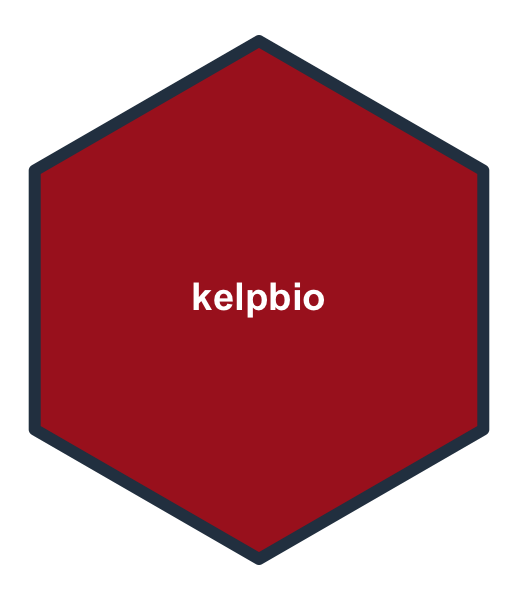
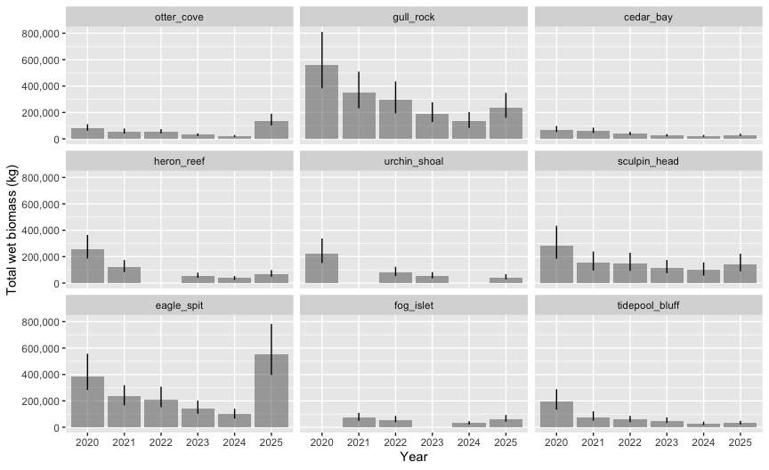

<!-- README.md is generated from README.Rmd. Please edit that file -->

# kelpbio 

<!-- badges: start -->

[](https://github.com/HakaiInstitute/kelpbio/actions/workflows/R-CMD-check.yaml)
[](https://hakaiinstitute.r-universe.dev/kelpbio)
[](https://hakaiinstitute.r-universe.dev/kelpbio)
[](https://lifecycle.r-lib.org/articles/stages.html#experimental)
<!-- badges: end -->

kelpbio estimates the biomass and carbon of *Nereocystis luetkeana* and
*Macrocystis pyrifera* kelp beds with Bayesian hierarchical models. The
total biomass of a site in a year combines three sources:

- plants counted and measured by in situ surveys;
- the canopy area mapped from drone or other imagery;
- a calibration model that relates the two.

Estimates are for the peak season, with uncertainty carried through from
every model to the totals.

## Installation

Install the pre-built binary from the Hakai R-universe (macOS and
Windows):

``` r
install.packages(
  "kelpbio",
  repos = c("https://hakaiinstitute.r-universe.dev", getOption("repos"))
)
```

Install from source (Linux, or to build from GitHub):

``` r
# install.packages("pak")
pak::pak("HakaiInstitute/kelpbio")
```

Source builds require a C++ toolchain:

- Linux: `sudo apt install build-essential`
- Windows: [Rtools](https://cran.r-project.org/bin/windows/Rtools/)
- macOS: `xcode-select --install`

## Usage

The examples use simulated data from made-up sites. The weight and size
models are fitted first.

``` r
library(kelpbio)

fit_weight <- kb_fit_weight_nereo(data_weight_sim_nereo)
fit_size <- kb_fit_size_nereo(data_size_sample_sim_nereo)
```

The biomass of each in situ survey is predicted from the two models and
the survey counts.

``` r
set.seed(1)
biomass <- kb_predict_biomass_in_situ(
  fit_weight,
  fit_size,
  data_in_situ_sim_nereo,
  progress = "none"
)
```

The cover calibration relates survey biomass to drone canopy cover.

``` r
fit_cover <- kb_fit_cover_calibration_nereo(biomass)
```

The calibration applied to each canopy map gives the total biomass of
each site and year, with 95% compatibility limits.

``` r
totals <- kb_predict_biomass_canopy(fit_cover, data_canopy_sim_nereo)
totals
#> <kb_predictions> response: biomass_kg | by: site, year
#> # A tibble: 49 × 11
#>    site      year  canopy_area_m2 canopy_tide_height_m classified_area_m2 region
#>    <fct>     <fct>          <dbl>                <dbl>              <dbl> <fct> 
#>  1 otter_co… 2020            7184                 0.2               16233 north 
#>  2 gull_rock 2020            9360                 1.55              17745 north 
#>  3 cedar_bay 2020           11370                 1.55              34020 north 
#>  4 heron_re… 2020            7193                 0                 19121 north 
#>  5 urchin_s… 2020           14175                 0.6               24213 south 
#>  6 sculpin_… 2020            8558                 1.25              21919 south 
#>  7 eagle_sp… 2020           16258                 1.5               46670 south 
#>  8 tidepool… 2020           10595                 1.4               19199 south 
#>  9 otter_co… 2021            3415                 1.3                5572 north 
#> 10 gull_rock 2021           14182                 1                 40162 north 
#> # ℹ 39 more rows
#> # ℹ 5 more variables: cover_support <chr>, biomass_kg <rvar[1d]>,
#> #   estimate <dbl>, lower <dbl>, upper <dbl>

kb_plot_predictions(totals)
```



## Learn more

- [Get
  started](https://hakaiinstitute.github.io/kelpbio/articles/kelpbio.html):
  data format, fitting, convergence, and predictions.
- [Advanced
  usage](https://hakaiinstitute.github.io/kelpbio/articles/advanced.html):
  priors, diagnostics, and the Stan ecosystem.
- [Methods](https://hakaiinstitute.github.io/kelpbio/articles/methods.html):
  the models and how predictions are computed.
- [kelpbiodata](https://github.com/HakaiInstitute/kelpbiodata): Hakai
  Institute data and models fitted to them.
- [kelpbioshiny](https://github.com/HakaiInstitute/kelpbioshiny): an app
  for running kelpbio without writing code.

## Citation

If you use kelpbio in your work, please cite it. Use `citation()` to get
a formatted citation and BibTeX entry:

``` r
citation("kelpbio")
#> To cite kelpbio in publications use:
#> 
#>   Dalgarno S (2026). _kelpbio: Bayesian Kelp Biomass Estimation_. R
#>   package version 0.0.0.9000,
#>   <https://github.com/HakaiInstitute/kelpbio>.
#> 
#> A BibTeX entry for LaTeX users is
#> 
#>   @Manual{,
#>     title = {kelpbio: Bayesian Kelp Biomass Estimation},
#>     author = {Seb Dalgarno},
#>     year = {2026},
#>     note = {R package version 0.0.0.9000},
#>     url = {https://github.com/HakaiInstitute/kelpbio},
#>   }
```

## Licensing

Copyright 2026 Tula Foundation.

The code is released under the [MIT License](LICENSE.md).
