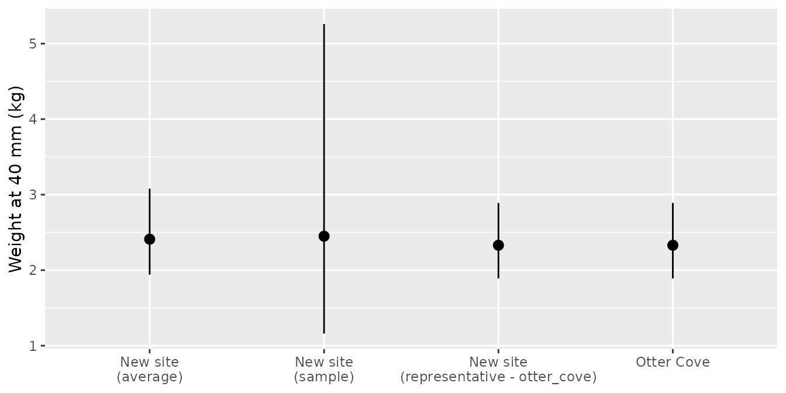
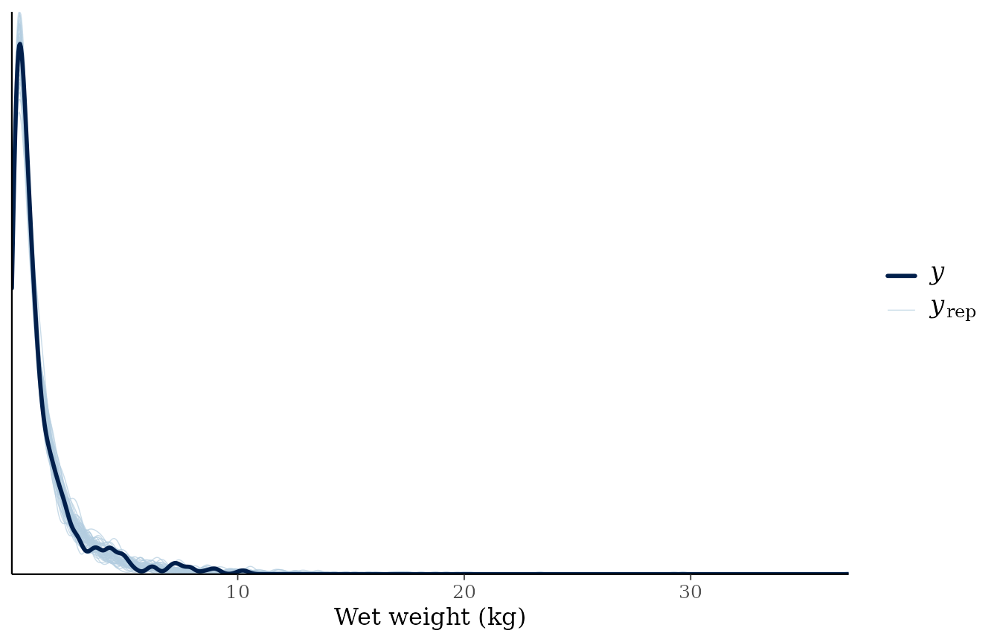
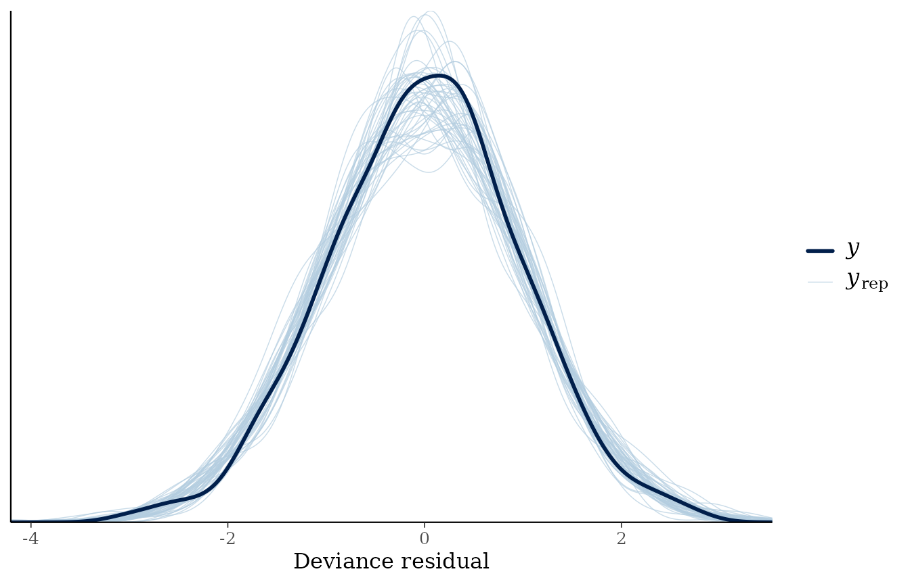
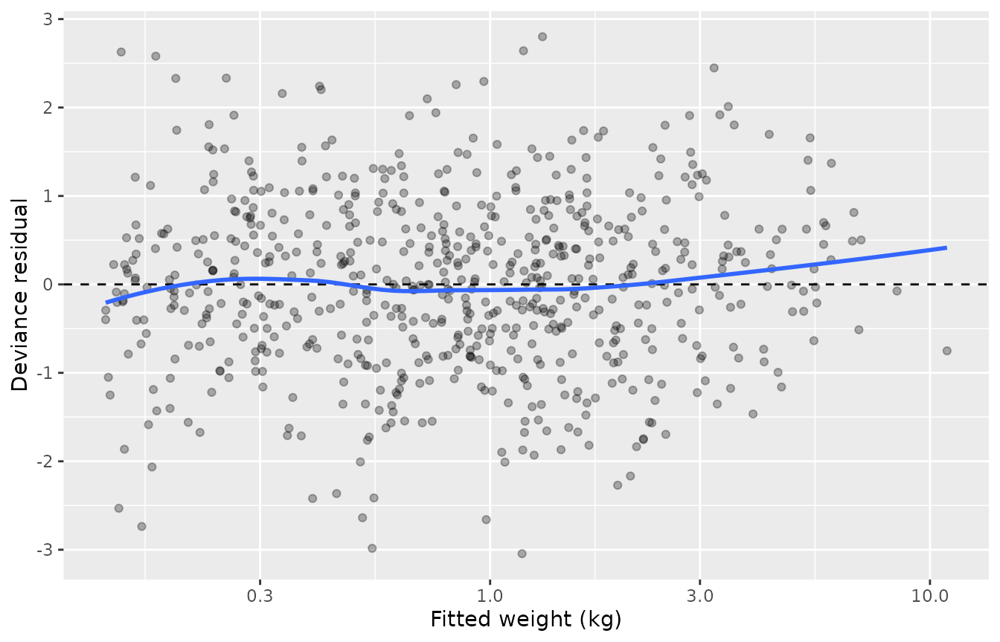
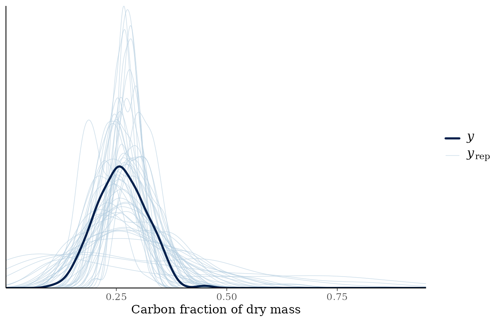
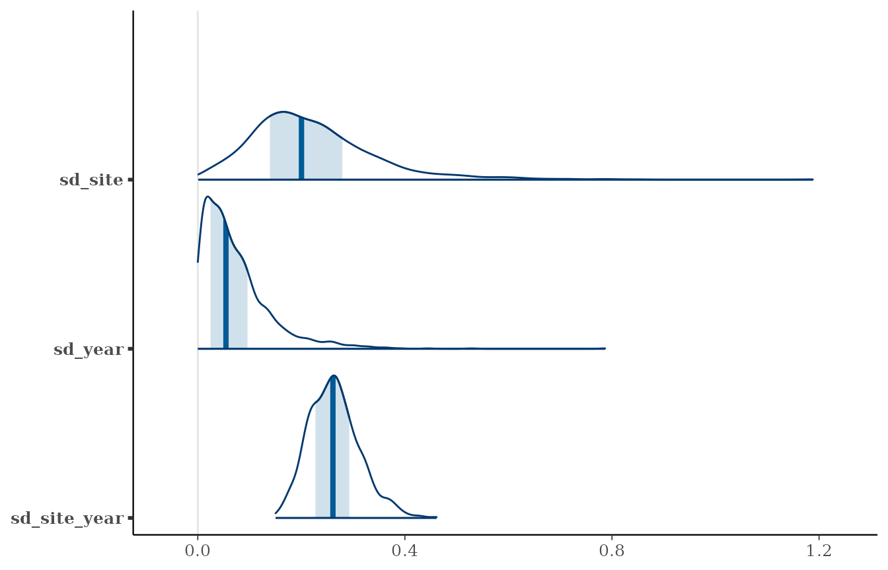

# Advanced usage

``` r

library(kelpbio)
library(dplyr)
library(ggplot2)
library(posterior)
```

This article covers priors, predictions for new sites and years,
diagnostics, and working with other packages in the Stan ‘ecosystem’. It
uses the pre-fit models included with the package, which are fitted to
simulated data with invented site names.

## Priors

A prior states what is plausible for a parameter before seeing the data.
Each model has default priors, one per parameter, which are intended to
be weakly informative, following Stan best practices (Gelman et al.
2017), except the informative prior on `tide_height_slope` in the cover
calibration (see
[Methods](https://hakaiinstitute.github.io/kelpbio/articles/methods.html#cover-calibration)).

``` r

kb_priors_carbon_nereo()
#> $intercept
#> normal(mean = -0.8, sd = 0.3)
#> 
#> $precision
#> exponential(rate = 0.001)
```

A list passed to `priors` replaces the entries it names.
[`prior_summary()`](https://mc-stan.org/rstantools/reference/prior_summary.html)
returns the priors that a model fit used.

With plenty of data the prior has little or no influence. With few data
it matters: here the carbon model is fitted to five samples with the
default prior, and with a prior that holds the carbon fraction near
0.40.

``` r

few <- data_carbon_sim_nereo[1:5, ]

fit_default <- kb_fit_carbon_nereo(few, seed = 1)
fit_informed <- kb_fit_carbon_nereo(
  few,
  priors = list(intercept = kb_prior_normal(mean = qlogis(0.40), sd = 0.05)),
  seed = 1
)

bind_rows(
  default = kb_predict_carbon(fit_default),
  informed = kb_predict_carbon(fit_informed),
  .id = "prior"
)
#> <kb_predictions> response: carbon_fraction
#> # A tibble: 2 × 4
#>   prior    estimate lower upper
#>   <chr>       <dbl> <dbl> <dbl>
#> 1 default     0.248 0.216 0.294
#> 2 informed    0.394 0.371 0.418
```

## New sites and years

A site or year that a model fit has no data for is defined as a ‘new
level’. The `new_levels` argument in `kb_predict_*()` functions sets how
it is predicted, with implications for the width of the uncertainty (95%
compatibility interval):

- `"average"`: the typical site or year. The interval describes an
  average site.
- `"sample"`: a site or year drawn from the estimated variation among
  sites or years (i.e., from the estimated random effect standard
  deviation). The interval is wider, and describes a new or unobserved
  site about which nothing is known.

The `representative_site` argument instead gives a new site the effects
of named sites in the model fit, e.g., when it is known a priori that
conditions at the new site are similar.

``` r

new_site <- data.frame(diameter_mm = 40, site = "new_reef")

set.seed(1)
bind_rows(
  average = kb_predict_weight(fit_weight_sim_nereo, new_site),
  sample = kb_predict_weight(
    fit_weight_sim_nereo,
    new_site,
    new_levels = "sample"
  ),
  representative = kb_predict_weight(
    fit_weight_sim_nereo,
    new_site,
    representative_site = "otter_cove"
  ),
  .id = "method"
)
#> <kb_predictions> predictor: diameter_mm | response: weight_kg | by: site
#> # A tibble: 3 × 6
#>   method         diameter_mm site     estimate lower upper
#>   <chr>                <dbl> <chr>       <dbl> <dbl> <dbl>
#> 1 average                 40 new_reef     2.41  1.94  3.08
#> 2 sample                  40 new_reef     2.45  1.16  5.26
#> 3 representative          40 new_reef     2.33  1.89  2.89
```

A new site with `representative_site = "otter_cove"` gets the same
estimate and interval as otter_cove itself.

``` r

set.seed(1)
bind_rows(
  "New site\n(average)" = kb_predict_weight(fit_weight_sim_nereo, new_site),
  "New site\n(sample)" = kb_predict_weight(
    fit_weight_sim_nereo,
    new_site,
    new_levels = "sample"
  ),
  "New site\n(representative - otter_cove)" = kb_predict_weight(
    fit_weight_sim_nereo,
    new_site,
    representative_site = "otter_cove"
  ),
  "Otter Cove" = kb_predict_weight(
    fit_weight_sim_nereo,
    data.frame(diameter_mm = 40, site = "otter_cove")
  ),
  .id = "method"
) |>
  mutate(method = factor(method, levels = unique(method))) |>
  ggplot(aes(x = method, y = estimate, ymin = lower, ymax = upper)) +
  geom_pointrange() +
  labs(x = NULL, y = "Weight at 40 mm (kg)")
```



## Diagnostics

### Posterior predictive check

[`pp_check()`](https://mc-stan.org/bayesplot/reference/pp_check.html)
compares the observed data (dark line) with datasets simulated from the
fitted model (light lines). A model that fits well produces simulated
data that look like the observed data.

``` r

pp_check(fit_weight_sim_nereo)
```



With `type = "residual"`, the function calculates and plots the deviance
residuals (i.e. from observed data and from simulated datasets) instead
of the data. Again, the observed residual distribution should fall
within the range of the residual distributions from simulated datasets.

``` r

pp_check(fit_weight_sim_nereo, type = "residual")
```



### Residuals

[`augment()`](https://generics.r-lib.org/reference/augment.html) adds
the fitted value and deviance residual of each observation to the data,
which can be plotted to check for patterns. In a model that fits well,
the residuals scatter evenly around zero across the range of fitted
values. A trend suggests the model’s form misses part of the
relationship, and a spread that changes with the fitted value suggests
the variance is misspecified.

``` r

augment(fit_weight_sim_nereo) |>
  ggplot(aes(x = fitted, y = residual)) +
  geom_hline(yintercept = 0, linetype = "dashed") +
  geom_point(alpha = 0.3) +
  geom_smooth(method = "loess", formula = y ~ x, se = FALSE) +
  scale_x_log10() +
  labs(x = "Fitted weight (kg)", y = "Deviance residual")
```



### Prior sensitivity

[`kb_sensitivity()`](https://hakaiinstitute.github.io/kelpbio/reference/kb_sensitivity.md)
uses [power-scaling sensitivity
analysis](https://mc-stan.org/priorsense/) to measure how much the
parameter estimates change when the prior is adjusted. Ideally,
estimates should be driven by the data and this is indicated when
`weak_prior` and `strong_data` are both `TRUE`. Where `weak_prior` is
`FALSE` the prior influences the estimate. In some cases, prior
influence is expected, e.g., when the user deliberately sets an
informative prior, or for the cover calibration’s tide correction
(`tide_height_slope`). It can also be an indication that the prior was
incorrectly specified or there are insufficient data to estimate a
parameter without relying on the prior. In the latter case, the prior
should be specified carefully, ideally based on plausible ranges or
parameter values from the literature.

The two flags give four cases:

- `weak_prior` and `strong_data`: the data drive the estimate.
- `strong_data` only: the prior and the data both move the estimate, a
  possible conflict; check the prior against what the data show.
- Neither: the prior dominates and the data say little about the
  parameter, so the prior needs a justification. This is expected where
  `informative_prior` is `TRUE`, as for the cover calibration’s
  `tide_height_slope`.
- `weak_prior` only: neither moves the estimate much, often a parameter
  the data identify only weakly.

``` r

kb_sensitivity(fit_weight_sim_nereo)
#> # A tibble: 7 × 6
#>   term         prior_cjs likelihood_cjs weak_prior strong_data informative_prior
#>   <chr>            <dbl>          <dbl> <lgl>      <lgl>       <lgl>            
#> 1 intercept      0.0105          0.0352 TRUE       FALSE       FALSE            
#> 2 diameter_po…   0.0223          0.0944 TRUE       TRUE        FALSE            
#> 3 weight_floor   0.0164          0.143  TRUE       TRUE        FALSE            
#> 4 sd_site        0.0365          0.0665 TRUE       TRUE        FALSE            
#> 5 sd_year        0.0300          0.0649 TRUE       TRUE        FALSE            
#> 6 sd_site_year   0.00918         0.151  TRUE       TRUE        FALSE            
#> 7 sd_residual    0.00181         0.224  TRUE       TRUE        FALSE
```

### Influential observations

[`kb_influence()`](https://hakaiinstitute.github.io/kelpbio/reference/kb_influence.md)
determines how strongly each observation affects the model fit if it was
removed, where a `pareto_k` above the threshold (0.7) indicates that it
is influential. Observations flagged as `influential` are not
necessarily wrong, but could be double-checked for data error. See the
loo package’s [Pareto k
diagnostic](https://mc-stan.org/loo/reference/pareto-k-diagnostic.html)
page for how `pareto_k` is calculated and interpreted.

``` r

kb_influence(fit_weight_sim_nereo) |>
  arrange(desc(pareto_k)) |>
  head(3)
#> # A tibble: 3 × 7
#>   diameter_mm weight_kg site       year  elpd_loo pareto_k influential
#>         <dbl>     <dbl> <fct>      <fct>    <dbl>    <dbl> <lgl>      
#> 1        22.4     0.122 heron_reef 2020     -2.78    0.422 FALSE      
#> 2        14.5     0.252 cedar_bay  2022      1.20    0.399 FALSE      
#> 3        52.3     2.56  eagle_spit 2020     -1.66    0.349 FALSE
```

### Prior predictive check

A fit with `prior_only = TRUE` ignores the data, which allows the user
to check whether the specified priors produce estimates within plausible
ranges, e.g., with
[`pp_check()`](https://mc-stan.org/bayesplot/reference/pp_check.html).
Here priors that hold the carbon fraction near 0.27 give carbon
fractions like those observed.

``` r

fit_prior <- kb_fit_carbon_nereo(
  data_carbon_sim_nereo,
  priors = list(
    intercept = kb_prior_normal(mean = -1, sd = 0.1),
    precision = kb_prior_exponential(rate = 0.01)
  ),
  prior_only = TRUE,
  seed = 1
)
set.seed(1)
pp_check(fit_prior)
```



## Doing more in the Stan ecosystem

kelpbio follows the [rstantools guidelines for developing Stan-based
packages](https://mc-stan.org/rstantools/articles/developer-guidelines.html).
A model fit object can be converted with
[`as_draws()`](https://mc-stan.org/posterior/reference/draws.html) to a
format accepted by packages like posterior, bayesplot, loo, priorsense
package, among others. Generics will feel familiar to users of other
Stan-based packages like [brms](https://paulbuerkner.com/brms/) (e.g.,
log_lik, posterior_predict, posterior_linpred, prior_summary).

Summarise the draws with posterior:

``` r

summarise_draws(fit_weight_sim_nereo) |>
  head()
#> # A tibble: 6 × 10
#>   variable    mean  median     sd    mad       q5    q95  rhat ess_bulk ess_tail
#>   <chr>      <dbl>   <dbl>  <dbl>  <dbl>    <dbl>  <dbl> <dbl>    <dbl>    <dbl>
#> 1 interce… -0.669  -0.666  0.126  0.115  -0.863   -0.470  1.00    1399.    1217.
#> 2 diamete…  2.92    2.92   0.108  0.111   2.75     3.10   1.00    1399.    1345.
#> 3 weight_…  0.118   0.118  0.0109 0.0109  0.101    0.137  1.00    1395.    1318.
#> 4 sd_site   0.220   0.200  0.121  0.102   0.0604   0.439  1.00     733.     589.
#> 5 sd_year   0.0721  0.0544 0.0675 0.0514  0.00539  0.206  1.00    1117.    1457.
#> 6 sd_site…  0.264   0.261  0.0490 0.0487  0.191    0.353  1.00    1082.    1460.
```

Plot them with bayesplot:

``` r

bayesplot::mcmc_areas(
  as_draws_array(fit_weight_sim_nereo),
  pars = c("sd_site", "sd_year", "sd_site_year")
)
```



Compare models with loo.
[`loo()`](https://mc-stan.org/loo/reference/loo.html) estimates how well
a model predicts new data, and
[`loo_compare()`](https://mc-stan.org/loo/reference/loo_compare.html)
ranks models by it, here the default *Nereocystis* weight model (a power
law with a weight floor) and its power-law-only form (`form = "power"`).
The best model is listed first; a model is clearly worse when its
`elpd_diff` is several times its `se_diff` below zero.

``` r

loo_compare(list(
  packard_floor = loo(fit_weight_sim_nereo),
  power = loo(fit_weight_sim_nereo_power)
))
#>          model elpd_diff se_diff p_worse diag_diff diag_elpd
#>  packard_floor       0.0     0.0      NA                    
#>          power     -67.7    12.3    1.00
```

Simulate new observations, as a draws-by-rows matrix, for a custom
check:

``` r

sizes <- data.frame(diameter_mm = c(20, 40, 60))

set.seed(1)
simulated <- posterior_predict(fit_weight_sim_nereo, sizes)
dim(simulated)
#> [1] 1500    3
```

| Function | Returns |
|----|----|
| [`tidy()`](https://generics.r-lib.org/reference/tidy.html) | Parameter estimates |
| [`glance()`](https://generics.r-lib.org/reference/glance.html) | Sample size and convergence |
| [`augment()`](https://generics.r-lib.org/reference/augment.html) | The data with fitted values and residuals |
| [`posterior_epred()`](https://mc-stan.org/rstantools/reference/posterior_epred.html) | Draws of the expected response |
| [`posterior_predict()`](https://mc-stan.org/rstantools/reference/posterior_predict.html) | Draws of new observations |
| [`log_lik()`](https://mc-stan.org/rstantools/reference/log_lik.html) | The pointwise log-likelihood |
| [`loo()`](https://mc-stan.org/loo/reference/loo.html) | Leave-one-out cross-validation |
| [`kb_stancode()`](https://hakaiinstitute.github.io/kelpbio/reference/kb_stancode.md) | The Stan code of the model |

## Custom derived quantities

The biomass functions return the posterior draws of each row in a column
next to `estimate`, `lower`, and `upper`. Arithmetic on that column is
done draw by draw, so a derived quantity keeps its full uncertainty.

The ratio of total biomass in 2025 to 2020, and the probability that
biomass was higher in 2025:

``` r

set.seed(1)
totals <- kb_predict_biomass_canopy(
  fit_cover_calibration_sim_nereo,
  data_survey_canopy_sim_nereo,
  pool_by = "year"
)
by_year <- setNames(totals$biomass_kg, totals$year)

(by_year["2025"] / by_year["2020"]) |> summarize_draws()
#> # A tibble: 1 × 10
#>   variable         mean median     sd    mad    q5   q95  rhat ess_bulk ess_tail
#>   <chr>           <dbl>  <dbl>  <dbl>  <dbl> <dbl> <dbl> <dbl>    <dbl>    <dbl>
#> 1 "(by_year[\"20… 0.639  0.632 0.0876 0.0781 0.512 0.796  1.00    1229.    1383.
Pr(by_year["2025"] > by_year["2020"])
#>  2025 
#> 0.002
```

## References

Gelman, Andrew, Daniel Simpson, and Michael Betancourt. 2017. “The Prior
Can Often Only Be Understood in the Context of the Likelihood.”
*Entropy* 19 (10): 555. <https://doi.org/10.3390/e19100555>.
