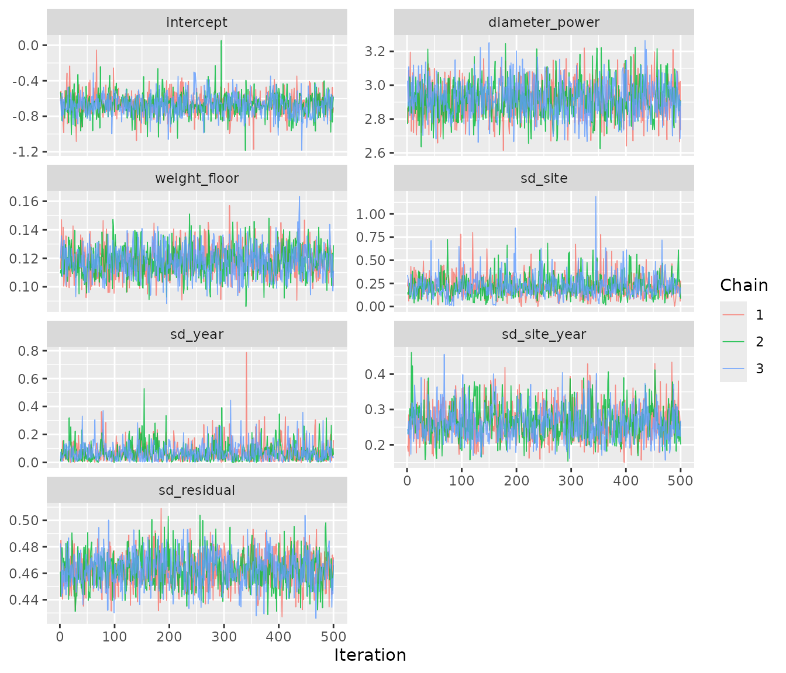
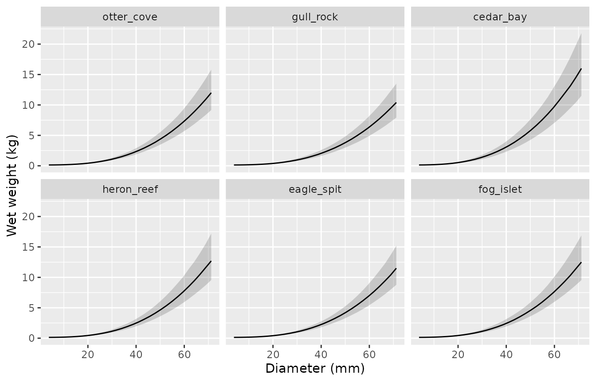
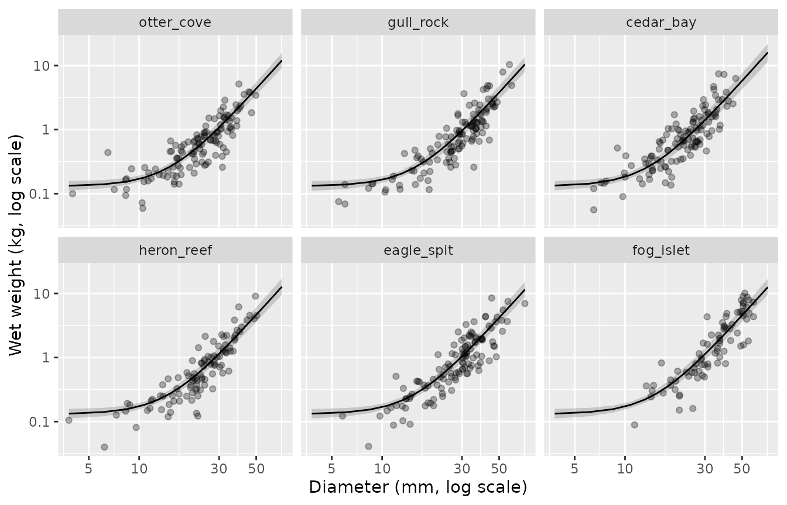
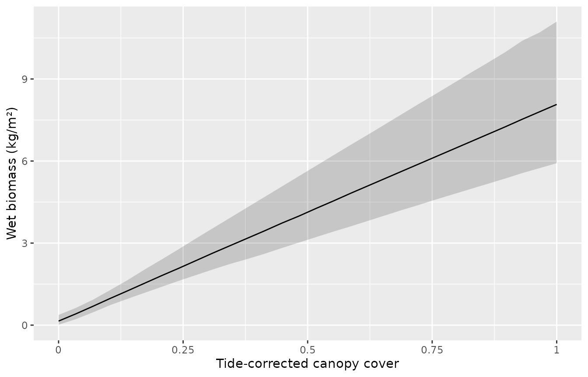
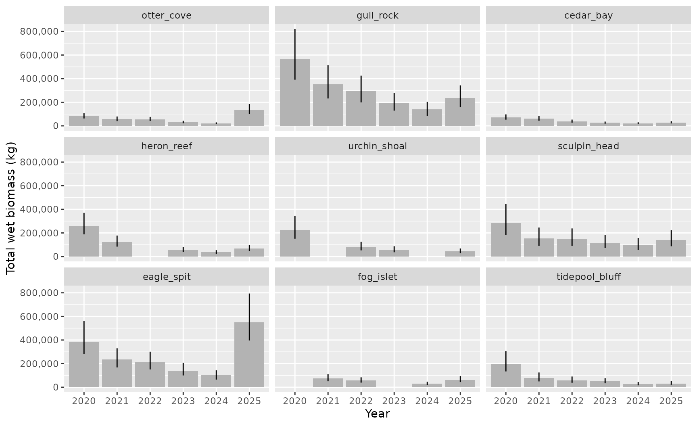
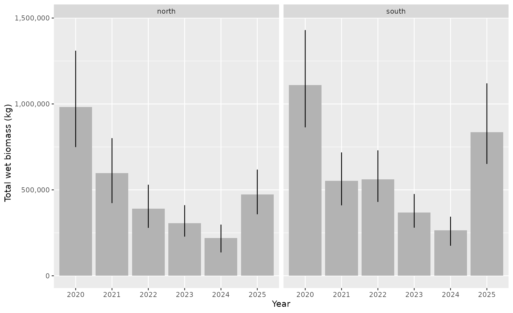

# Get started with kelpbio

``` r

library(kelpbio)
library(ggplot2)
```

kelpbio estimates the biomass of *Nereocystis luetkeana* and
*Macrocystis pyrifera*. Total biomass combines plants counted and
measured in in situ surveys, the surface canopy area mapped from aerial
imagery, and a calibration model that relates the two. See the
[Methods](https://hakaiinstitute.github.io/kelpbio/articles/methods.html)
article for more details on methods, including expected survey design
and timing, general statistical approach, model descriptions, and how
sub-models are combined to get predictions.

This article uses *Nereocystis* as an example. The data shown below are
simulated, with invented site names.

## Glossary

- **Plant**: one individual (sporophyte), identified by its holdfast
  (*Macrocystis*) or stipe (*Nereocystis*).
- **In situ survey**: count of the plants within a surveyed area, with
  all or a sample of the plants measured (e.g., three 30 m sub-surface
  transects with 2 m swaths, and the maximum sub-bulb diameter measured
  for 15 plants per transect).
- **Plot**: area bounding the in situ survey, over which canopy percent
  cover is calculated.
- **Canopy map**: surface canopy within a site mapped from aerial
  imagery, with the tide height recorded at the time of imaging.
- **Site**: a location of any size with mapped canopy and possibly,
  matching in situ survey data.
- **Site-year**: annual snapshot of a site, i.e., in peak season.

## Data format

Each dataset is a table with a set of required column names and values,
formatted for model fitting. Expected units are in the column names
(e.g., `diameter_mm`). The [Data
format](https://hakaiinstitute.github.io/kelpbio/articles/data-format.md)
article describes what each dataset holds, how the datasets are linked,
and their columns, as given by
[`kb_data_columns()`](https://hakaiinstitute.github.io/kelpbio/reference/kb_data_columns.md).
Each dataset has a `kb_check_data_*()` function that checks it.

## Fit a model

The weight model relates plant weight to diameter, allowing for
differences among sites and years.

``` r

fit <- kb_fit_weight_nereo(data_weight_sim_nereo)
```

[`kb_model_describe()`](https://hakaiinstitute.github.io/kelpbio/reference/kb_model_describe.md)
prints a detailed description of the fitted model, including its priors.
[`kb_stancode()`](https://hakaiinstitute.github.io/kelpbio/reference/kb_stancode.md)
prints the underlying Stan code.

``` r

kb_model_describe(fit)
#> Weight allometry - Nereocystis luetkeana
#> Response: wet weight (kg); predictor: plant diameter (mm)
#> 
#> Likelihood
#>   log(weight_kg) ~ Normal(log(mu), sd_residual)
#>   mu = weight_floor + alpha * x^diameter_power
#>   log(alpha) = intercept
#>              + site_effect[site]
#>              + year_effect[year]
#>              + site_year_effect[site, year]
#>   x = diameter_mm / d0,  d0 = 24.9 mm  (geometric mean diameter)
#> 
#> Random effects
#>   site_effect[site]            ~ Normal(0, sd_site)       site effect on log(alpha)
#>   year_effect[year]            ~ Normal(0, sd_year)       year effect on log(alpha)
#>   site_year_effect[site, year] ~ Normal(0, sd_site_year)  site:year effect on log(alpha)
#> 
#> Priors
#>   intercept      ~ Normal(0, 2)
#>   diameter_power ~ Normal(2, 1) T[0, ]
#>   weight_floor   ~ Normal(0, 0.5) T[0, ]
#>   sd_residual    ~ Exponential(1)
#>   sd_site        ~ Exponential(1)
#>   sd_year        ~ Exponential(1)
#>   sd_site_year   ~ Exponential(1)
```

[`tidy()`](https://generics.r-lib.org/reference/tidy.html) or
[`coef()`](https://rdrr.io/r/stats/coef.html) gives the estimate of each
parameter with its lower and upper 95% compatibility limits.

``` r

tidy(fit)
#> # A tibble: 7 × 4
#>   term           estimate    lower  upper
#>   <chr>             <dbl>    <dbl>  <dbl>
#> 1 intercept       -0.666  -0.918   -0.421
#> 2 diameter_power   2.92    2.71     3.13 
#> 3 weight_floor     0.118   0.098    0.14 
#> 4 sd_site          0.2     0.0406   0.521
#> 5 sd_year          0.0544  0.00298  0.254
#> 6 sd_site_year     0.261   0.179    0.372
#> 7 sd_residual      0.463   0.438    0.488
```

Model convergence can be checked with
[`glance()`](https://generics.r-lib.org/reference/glance.html) or
[`kb_converged()`](https://hakaiinstitute.github.io/kelpbio/reference/kb_converged.md).
A converged model must meet thresholds for R-hat, effective sample size
(ESS), and divergent transitions. See
[`?kb_converged`](https://hakaiinstitute.github.io/kelpbio/reference/kb_converged.md)
for definitions and suggestions for resolving convergence failures.

``` r

glance(fit)
#> # A tibble: 1 × 10
#>       n     K nchains niters nthin ess_bulk ess_tail  rhat perc_divergent
#>   <int> <int>   <int>  <dbl> <int>    <dbl>    <dbl> <dbl>          <dbl>
#> 1   660     7       3    500     4     733.     589.  1.00              0
#> # ℹ 1 more variable: converged <lgl>
```

In a converged model, the chains of each parameter overlap and should
resemble a ‘fuzzy caterpillar’.

``` r

kb_plot_trace(fit)
```



See the [advanced usage
article](https://hakaiinstitute.github.io/kelpbio/articles/advanced.html)
for more diagnostics.

## Predict and plot

The `kb_predict_*()` functions take a fit object and generate
predictions (estimates with 95% compatibility limits).

If no new data are supplied, predictions are made for each row of the
data the model was fitted to.

``` r

kb_predict_weight(fit)
#> <kb_predictions> predictor: diameter_mm | response: weight_kg | by: site, year
#> # A tibble: 660 × 8
#>    diameter_mm weight_kg site       year  weight_support estimate lower upper
#>          <dbl>     <dbl> <fct>      <fct> <chr>             <dbl> <dbl> <dbl>
#>  1        28.6     0.663 otter_cove 2020  site-year         0.779 0.632 0.96 
#>  2        16.5     0.569 otter_cove 2020  site-year         0.262 0.23  0.299
#>  3        27.3     0.841 otter_cove 2020  site-year         0.697 0.567 0.855
#>  4        38.3     1.38  otter_cove 2020  site-year         1.64  1.31  2.08 
#>  5        16.2     0.153 otter_cove 2020  site-year         0.255 0.224 0.291
#>  6        29.8     0.793 otter_cove 2020  site-year         0.861 0.697 1.06 
#>  7        34.7     1.36  otter_cove 2020  site-year         1.27  1.01  1.58 
#>  8        16.2     0.141 otter_cove 2020  site-year         0.255 0.224 0.291
#>  9        25.9     0.311 otter_cove 2020  site-year         0.615 0.505 0.752
#> 10        35.5     1.53  otter_cove 2020  site-year         1.34  1.07  1.68 
#> # ℹ 650 more rows
```

New data can be supplied to predict at specific values, including values
not in the observed data.

``` r

new_dat <- data.frame(site = "otter_cove", year = 2023, diameter_mm = c(15, 20))
kb_predict_weight(fit, new_data = new_dat)
#> <kb_predictions> predictor: diameter_mm | response: weight_kg | by: site, year
#> # A tibble: 2 × 7
#>   site        year diameter_mm weight_support estimate lower upper
#>   <chr>      <dbl>       <dbl> <chr>             <dbl> <dbl> <dbl>
#> 1 otter_cove  2023          15 site-year         0.242 0.213 0.277
#> 2 otter_cove  2023          20 site-year         0.388 0.321 0.469
```

[`kb_new_data()`](https://hakaiinstitute.github.io/kelpbio/reference/kb_new_data.md)
is a helper that generates a grid of new data, e.g., the full range of
diameters at each site, and the predictions can be plotted with
[`kb_plot_predictions()`](https://hakaiinstitute.github.io/kelpbio/reference/kb_plot_predictions.md).

``` r

predictions <- kb_predict_weight(fit, kb_new_data(fit, by = "site"))
kb_plot_predictions(predictions)
```



The plot is a ggplot object, so the data can be added as a layer.

``` r

kb_plot_predictions(predictions, log_axis = "xy") +
  geom_point(
    data = data_weight_sim_nereo,
    aes(x = diameter_mm, y = weight_kg),
    alpha = 0.3,
    inherit.aes = FALSE
  )
```



See the [advanced usage
article](https://hakaiinstitute.github.io/kelpbio/articles/advanced.html)
for control over how uncertainty is estimated for a new site or year
(i.e., one not in the data the model was fitted to).

## From plants to total biomass

### In situ biomass

The biomass (kg/m²) of an in situ survey is the number of plants counted
times their mean weight, over the area surveyed. Mean weight is
estimated, with uncertainty, from the weight model and a size model
fitted to a sample of measured plants (see [Censused
areas](#censused-areas) for surveys where all plants are measured).

``` r

fit_size <- kb_fit_size_nereo(data_size_sample_sim_nereo)
```

``` r

data_survey_in_situ_sim_nereo
#> # A tibble: 54 × 8
#>    survey_id       site  year  survey_area_m2 plants plot_area_m2 canopy_area_m2
#>    <chr>           <fct> <fct>          <dbl>  <int>        <dbl>          <dbl>
#>  1 otter_cove-202… otte… 2020            140     992         215            87.3
#>  2 otter_cove-202… otte… 2020             80     297         262.          110. 
#>  3 gull_rock-2020… gull… 2020            233.    660         233.           30.3
#>  4 cedar_bay-2020… ceda… 2020             40       0         270.           34.3
#>  5 cedar_bay-2020… ceda… 2020            180     861         255.           81.2
#>  6 heron_reef-202… hero… 2020            120     550         217.           73.5
#>  7 urchin_shoal-2… urch… 2020            160    1815         218.          116. 
#>  8 sculpin_head-2… scul… 2020            193.   1245         193.           30.1
#>  9 eagle_spit-202… eagl… 2020            200     471         259.           97.3
#> 10 tidepool_bluff… tide… 2020            180     698         229            62.3
#> # ℹ 44 more rows
#> # ℹ 1 more variable: canopy_tide_height_m <dbl>

set.seed(1)
biomass <- kb_predict_biomass_in_situ(
  fit_weight_sim_nereo,
  fit_size_sim_nereo,
  data_survey_in_situ_sim_nereo,
  progress = "none"
)
biomass
#> <kb_predictions> response: biomass_kg_m2 | by: site, year
#> # A tibble: 54 × 14
#>    survey_id       site  year  survey_area_m2 plants plot_area_m2 canopy_area_m2
#>    <chr>           <fct> <fct>          <dbl>  <int>        <dbl>          <dbl>
#>  1 otter_cove-202… otte… 2020            140     992         215            87.3
#>  2 otter_cove-202… otte… 2020             80     297         262.          110. 
#>  3 gull_rock-2020… gull… 2020            233.    660         233.           30.3
#>  4 cedar_bay-2020… ceda… 2020             40       0         270.           34.3
#>  5 cedar_bay-2020… ceda… 2020            180     861         255.           81.2
#>  6 heron_reef-202… hero… 2020            120     550         217.           73.5
#>  7 urchin_shoal-2… urch… 2020            160    1815         218.          116. 
#>  8 sculpin_head-2… scul… 2020            193.   1245         193.           30.1
#>  9 eagle_spit-202… eagl… 2020            200     471         259.           97.3
#> 10 tidepool_bluff… tide… 2020            180     698         229            62.3
#> # ℹ 44 more rows
#> # ℹ 7 more variables: canopy_tide_height_m <dbl>, weight_support <chr>,
#> #   size_support <chr>, biomass_kg_m2 <rvar[1d]>, estimate <dbl>, lower <dbl>,
#> #   upper <dbl>
```

### Cover calibration

The cover calibration model relates the estimated biomass of each in
situ survey to the percent cover of canopy mapped (e.g., by drone or
satellite imagery) within the plot bounding the survey.

``` r

fit_cover <- kb_fit_cover_calibration_nereo(biomass)
```

``` r

fit_cover <- fit_cover_calibration_sim_nereo

kb_predict_cover_calibration(fit_cover, kb_new_data(fit_cover)) |>
  kb_plot_predictions()
```



### Total biomass

The cover calibration model is applied to each canopy map to estimate
its total biomass.

``` r

data_survey_canopy_sim_nereo
#> # A tibble: 49 × 6
#>    site      year  canopy_area_m2 canopy_tide_height_m classified_area_m2 region
#>    <fct>     <fct>          <dbl>                <dbl>              <dbl> <fct> 
#>  1 otter_co… 2020            6817                 1.2               18504 north 
#>  2 gull_rock 2020           53242                 0.15             142539 north 
#>  3 cedar_bay 2020            5893                 1.05              11737 north 
#>  4 heron_re… 2020           24787                 0.6               51227 north 
#>  5 urchin_s… 2020           20431                 0.75              55633 south 
#>  6 sculpin_… 2020           16455                 1                 45632 south 
#>  7 eagle_sp… 2020           38273                 1.3               76960 south 
#>  8 tidepool… 2020           20110                 0.2               41234 south 
#>  9 otter_co… 2021            4819                 1.6                9556 north 
#> 10 gull_rock 2021           38877                 0.2               83128 north 
#> # ℹ 39 more rows

totals <- kb_predict_biomass_canopy(fit_cover, data_survey_canopy_sim_nereo)
totals
#> <kb_predictions> response: biomass_kg | by: site, year
#> # A tibble: 49 × 11
#>    site      year  canopy_area_m2 canopy_tide_height_m classified_area_m2 region
#>    <fct>     <fct>          <dbl>                <dbl>              <dbl> <fct> 
#>  1 otter_co… 2020            6817                 1.2               18504 north 
#>  2 gull_rock 2020           53242                 0.15             142539 north 
#>  3 cedar_bay 2020            5893                 1.05              11737 north 
#>  4 heron_re… 2020           24787                 0.6               51227 north 
#>  5 urchin_s… 2020           20431                 0.75              55633 south 
#>  6 sculpin_… 2020           16455                 1                 45632 south 
#>  7 eagle_sp… 2020           38273                 1.3               76960 south 
#>  8 tidepool… 2020           20110                 0.2               41234 south 
#>  9 otter_co… 2021            4819                 1.6                9556 north 
#> 10 gull_rock 2021           38877                 0.2               83128 north 
#> # ℹ 39 more rows
#> # ℹ 5 more variables: cover_support <chr>, biomass_kg <rvar[1d]>,
#> #   estimate <dbl>, lower <dbl>, upper <dbl>

kb_plot_predictions(totals, geom = "bar")
```



`pool_by` pools the estimates by group, in this case to give the total
biomass in each year and region, summed across sites, with the
uncertainty of the sum.

``` r

set.seed(1)
kb_predict_biomass_canopy(
  fit_cover,
  data_survey_canopy_sim_nereo,
  pool_by = c("region", "year")
) |>
  kb_plot_predictions(geom = "bar")
```



See the [methods
article](https://hakaiinstitute.github.io/kelpbio/articles/methods.html#survey-design)
for more detail, including a diagram of a typical survey layout that
shows how a plot relates to its site.

### Dry, carbon, and nitrogen biomass

A wet/dry model fit converts wet to dry biomass, a carbon model fit
converts dry biomass to carbon, and a nitrogen model fit converts dry
biomass to nitrogen.

``` r

kb_predict_biomass_canopy(
  fit_cover,
  data_survey_canopy_sim_nereo,
  wetdry = fit_wetdry_sim_nereo,
  carbon = fit_carbon_sim_nereo,
  measure = "carbon"
)
#> <kb_predictions> response: carbon_biomass_kg | by: site, year
#> # A tibble: 49 × 11
#>    site      year  canopy_area_m2 canopy_tide_height_m classified_area_m2 region
#>    <fct>     <fct>          <dbl>                <dbl>              <dbl> <fct> 
#>  1 otter_co… 2020            6817                 1.2               18504 north 
#>  2 gull_rock 2020           53242                 0.15             142539 north 
#>  3 cedar_bay 2020            5893                 1.05              11737 north 
#>  4 heron_re… 2020           24787                 0.6               51227 north 
#>  5 urchin_s… 2020           20431                 0.75              55633 south 
#>  6 sculpin_… 2020           16455                 1                 45632 south 
#>  7 eagle_sp… 2020           38273                 1.3               76960 south 
#>  8 tidepool… 2020           20110                 0.2               41234 south 
#>  9 otter_co… 2021            4819                 1.6                9556 north 
#> 10 gull_rock 2021           38877                 0.2               83128 north 
#> # ℹ 39 more rows
#> # ℹ 5 more variables: cover_support <chr>, carbon_biomass_kg <rvar[1d]>,
#> #   estimate <dbl>, lower <dbl>, upper <dbl>
```

## Pre-fit models

The kelpbiodata package holds public datasets, with models pre-fit to
them. The pre-fit models can be used when data have not been collected
at your sites for a particular sub-model, such as harvested plants for
weight allometry or tissue samples for the dry:wet ratio and carbon
fraction. There is a pre-fit model for every sub-model, including the
cover calibration, so canopy biomass can be estimated from a canopy map
alone.

``` r

set.seed(1)
kb_predict_biomass_in_situ(
  kelpbiodata::fit_weight_hakai_nereo,
  kelpbiodata::fit_size_hakai_nereo,
  data_survey_in_situ_sim_nereo[1:3, ],
  progress = "none"
)
#> <kb_predictions> response: biomass_kg_m2 | by: site, year
#> # A tibble: 3 × 14
#>   survey_id        site  year  survey_area_m2 plants plot_area_m2 canopy_area_m2
#>   <chr>            <fct> <fct>          <dbl>  <int>        <dbl>          <dbl>
#> 1 otter_cove-2020… otte… 2020            140     992         215            87.3
#> 2 otter_cove-2020… otte… 2020             80     297         262.          110. 
#> 3 gull_rock-2020-1 gull… 2020            233.    660         233.           30.3
#> # ℹ 7 more variables: canopy_tide_height_m <dbl>, weight_support <chr>,
#> #   size_support <chr>, biomass_kg_m2 <rvar[1d]>, estimate <dbl>, lower <dbl>,
#> #   upper <dbl>
```

Sites or years in the user’s data that are not in the pre-fit model’s
dataset are treated as new levels, so their estimates have wider
uncertainty.

User data can also be combined with a kelpbiodata dataset to increase
the number of observations. For example, if plants have been harvested
at only a couple of sites, combining them with the kelpbiodata Hakai
Institute weight data gives a better estimate of the general weight
allometry relationship, while the site-level random effect still gives
an estimate for each site of interest from the user’s data.

``` r

data_weight <- dplyr::bind_rows(
  kelpbiodata::data_weight_hakai_nereo,
  dplyr::filter(data_weight_sim_nereo, site %in% c("otter_cove", "gull_rock"))
)

# 3 chains of 500 draws match the 1500 draws of fit_size_sim_nereo.
fit_combined <- kb_fit_weight_nereo(
  data_weight,
  chains = 3L,
  niters = 500L,
  nthin = 4L,
  seed = 1L,
  progress = "none",
  control = list(adapt_delta = 0.99)
)

set.seed(1)
kb_predict_biomass_in_situ(
  fit_combined,
  fit_size_sim_nereo,
  data_survey_in_situ_sim_nereo[1:3, ],
  progress = "none"
)
```

## Censused areas

If every plant within a survey area is counted and measured (a full
census), a size model is not needed, and `per_area = FALSE` gives the
total biomass in the surveyed area. The uncertainty in biomass then
comes only from the weight model. When every plant in a site is counted
and measured, no calibration is needed.

``` r

data_size_census_sim_nereo
#> # A tibble: 6,022 × 3
#>    survey_id         diameter_mm partial
#>    <chr>                   <dbl> <lgl>  
#>  1 otter_cove-2020-1        28.9 FALSE  
#>  2 otter_cove-2020-1        15.5 TRUE   
#>  3 otter_cove-2020-1        18.6 FALSE  
#>  4 otter_cove-2020-1        21.6 FALSE  
#>  5 otter_cove-2020-1        40.4 FALSE  
#>  6 otter_cove-2020-1        24.5 FALSE  
#>  7 otter_cove-2020-1        30.7 FALSE  
#>  8 otter_cove-2020-1         9.2 TRUE   
#>  9 otter_cove-2020-1        35.1 FALSE  
#> 10 otter_cove-2020-1        23.4 FALSE  
#> # ℹ 6,012 more rows

# The censused surveys, with their counts taken from the census.
census_surveys <- dplyr::filter(
  data_survey_in_situ_sim_nereo,
  survey_id %in% data_size_census_sim_nereo$survey_id
)
census_surveys <- dplyr::select(census_surveys, -plants)

kb_predict_biomass_in_situ(
  fit_weight_sim_nereo,
  data_size_census_sim_nereo,
  census_surveys,
  per_area = FALSE,
  progress = "none"
)
#> Warning: 5 values of diameter_mm lie far outside the fitted range (3.8 to 71.2).
#> ℹ Check that the values are in millimetres.
#> <kb_predictions> response: biomass_kg | by: site, year
#> # A tibble: 7 × 12
#>   survey_id         site       year  survey_area_m2 plot_area_m2 canopy_area_m2
#>   <chr>             <fct>      <fct>          <dbl>        <dbl>          <dbl>
#> 1 otter_cove-2020-1 otter_cove 2020            140          215            87.3
#> 2 otter_cove-2020-2 otter_cove 2020             80          262.          110. 
#> 3 otter_cove-2021-1 otter_cove 2021            250.         250.          146. 
#> 4 otter_cove-2022-1 otter_cove 2022            232          232            70.6
#> 5 otter_cove-2023-1 otter_cove 2023            160          269.           41.6
#> 6 otter_cove-2024-1 otter_cove 2024            180          260.           43.9
#> 7 otter_cove-2025-1 otter_cove 2025            220          270.          196. 
#> # ℹ 6 more variables: canopy_tide_height_m <dbl>, weight_support <chr>,
#> #   biomass_kg <rvar[1d]>, estimate <dbl>, lower <dbl>, upper <dbl>
```

## *Macrocystis*

Every counted *Macrocystis* plant has its fronds recorded, so a size
census is always used in place of a size model. The calibration and
totals follow as for *Nereocystis*.

``` r

set.seed(1)
biomass_macro <- kb_predict_biomass_in_situ(
  fit_weight_sim_macro,
  data_size_census_sim_macro,
  data_survey_in_situ_sim_macro,
  progress = "none"
)
```

## More information

For additional information:

- [Data
  format](https://hakaiinstitute.github.io/kelpbio/articles/data-format.html)
  lists the datasets, their columns, and how they link.
- [Methods](https://hakaiinstitute.github.io/kelpbio/articles/methods.html)
  describes the models and how predictions are computed.
- [Advanced
  usage](https://hakaiinstitute.github.io/kelpbio/articles/advanced.html)
  covers priors, diagnostics, and working with other Stan packages.
