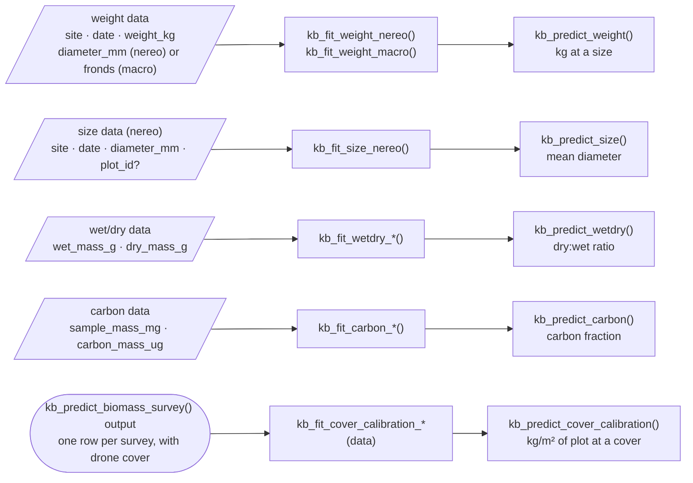
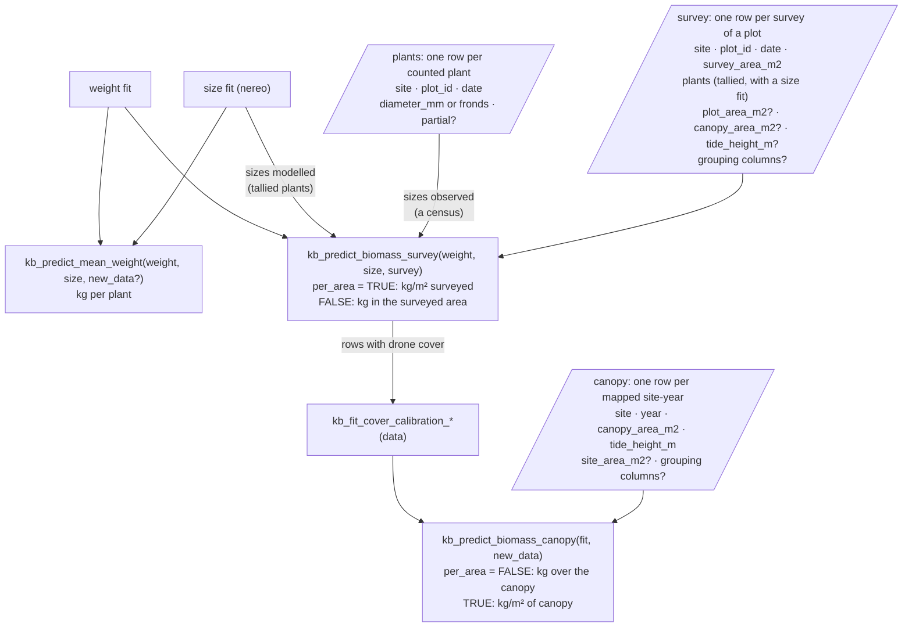
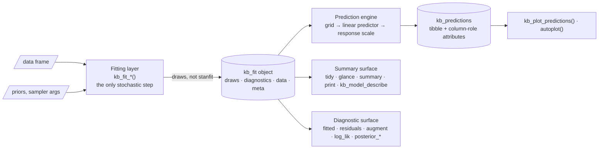

# kelpbio Architecture

> The durable shape of the package and the rules that decide where new code goes.
> Behaviour lives in `openspec/specs/`; the other files in `decisions/` hold the
> rationale for specific choices. For a detailed map of the current internals,
> generate one from the code (the `describe-design` skill does this) rather than
> maintaining it here.

## Overview

kelpbio fits Bayesian hierarchical kelp-biomass models with Stan and exposes them
through a small S3 surface built on the tidyverse and `posterior`. Stan sources in
`inst/stan/` are compiled into the package binary at `R CMD INSTALL`, so users need
no Stan toolchain (`decisions/engine-choice.md`).

The organising decision is that a fit object stores **extracted posterior draws,
not the live `stanfit`**. Fitting is the only stochastic step; everything
downstream (summaries, diagnostics, predictions, plots) is `posterior` arithmetic
over stored draws. Fit objects are therefore small, portable, robust across rstan
versions, and a pre-fit model is not a special case (`decisions/prediction-engine.md`).

The package fits weight, wet/dry, carbon, and cover calibration models for
*Nereocystis luetkeana* and *Macrocystis pyrifera*, and a size model for
*Nereocystis*. It composes them into the biomass of in situ surveys (each
counted plant's expected weight, summed over the area searched) and into biomass
over drone-mapped canopy (the cover calibration applied to canopy area).

## Models, verbs, and data

Model verbs report one fitted model's expected response and are named for the
model. Derived verbs combine fits with the user's data and are named for what the
biomass comes from. Data inputs list their columns; `?` marks an optional column.

Fits and model verbs:

Biomass (derived verbs):

Estimates are for the peak season at site-year resolution: every model has site
and year effects only. A plot may be surveyed more than once, and a site-year may
hold several plots; each survey with drone cover (`plot_area_m2`,
`canopy_area_m2`, and `tide_height_m` on its row) is one observation in the cover
calibration. In every dated table (weight, size, survey, plants) `year` comes
from `date`. A survey's plants come from the plant rows,
joined by `site`, `plot_id`, and `date`, when every plant was measured, and from
its tallied `plants` column when sizes come from a size fit; a survey with no
plant rows is zero. Biomass per m² divides by `survey_area_m2`, the area
searched; cover divides canopy by `plot_area_m2`, and the calibration takes a
survey's biomass per m² as its plot's. "Plant" stands for one
individual (sporophyte) identified by its holdfast, in both species.

The derived verbs share `wetdry` and `carbon` fits with `measure` (wet, dry, or
carbon), `new_levels` (default `"sample"`), `representative_site`, and the
summary trio. Their output carries the response as an `rvar` column of draws
next to `estimate`, `lower`, and `upper`, so one verb's output can feed another:
the cover calibration fit reads the mean and SD of `biomass_kg_m2` from
unsummed `kb_predict_biomass_survey()` output. `kb_predict_mean_weight()` takes
fits only and has no `pool_by`. The two biomass verbs take `pool_by`: `NULL` gives
one row per input row; column names give one row per group, with kg summed and,
per area, divided by the summed area, draw by draw.

## Layers

Everything to the right of the fit object reads stored draws and metadata and never
re-enters Stan. That boundary is what makes the whole surface testable without
MCMC and makes a pre-fit model behave exactly like a fresh one.

- **Fitting.** Each `kb_fit_<model>_<species>()` validates its inputs, derives the
  model structure from the data (which effects are fitted), assembles the Stan data
  list with priors as data, samples through one shared engine, and builds the fit
  object. The structure is decided by pure helpers, so it is tested without MCMC.
- **Prediction.** The prediction verbs and the `posterior_*()` generics resolve a
  grid of rows to one linear predictor (per-row random-effect and covariate
  resolution), then map it to the response scale. The mean is defined once per
  model, in R, mirroring the Stan file.
- **Summaries.** Parameter summaries, diagnostics, and print output read the stored
  draws and diagnostics; the model description is rendered from the fit's stored
  priors and structure.

## Why the Nereocystis likelihood is Normal on log weight

Biomass averages expected weight over the size distribution. Under a Student-t on
log weight, `E[weight]` does not exist, so the integration would have nothing to
average. The Normal gives the expected weight `exp(mu + sd_residual^2 / 2)`.

## The observation distribution is stated once in R

The pointwise log-likelihood, deviance residuals, and posterior-predictive
replicates are computed in R from the stored draws, not in Stan `generated
quantities`: that would store `D x N` values in every fit, pre-fit, and fixture,
turn every diagnostic fix into a `.stan` edit and a refit, and put the saturated
likelihoods that deviance residuals need (found by bisection for some families)
where they cannot be unit-tested.

Each model states its distribution once, in its `.obs_family()` method: an
extras-style family name, the response, and the family's parameters per draw.
`log_lik()`, `residuals()`, `augment()`, and `posterior_predict()` evaluate that
one statement through a table of `log_lik_*`/`res_*`/`ran_*` functions, so they
cannot use different parameterisations. The family name could be a frozen `meta`
value, but it must agree with the parameter mapping, which is arithmetic, so both
stay in the method (see "Meta Versus Dispatch"). Models on the log of a response
use the `lnorm` family on the response itself, so `log_lik()` is always the
density of the recorded response. The expected response stays in `.epred()`, on
`rvar`s (`decisions/prediction-engine.md`).

The likelihood is still written twice, in Stan and in R. A test evaluates the
Stan model's log density with and without the likelihood (`prior_only`) at random
parameter values and checks the difference against `log_lik()`, so the two cannot
drift apart.

## Random-effect resolution

A known level conditions on its estimated effect regardless of `new_levels`; only an
unknown or absent level consults it. That lets a mix of observed and new groups
resolve in one call. Optional covariates follow the same idea: a row's own value,
then a value recorded at fit time, then a neutral default.

## Meta Versus Dispatch

Every per-model fact is either a value stored in `meta` at fit time or an internal
generic dispatching on the fit subclass. The rule, applied in order:

1.  **Can it be computed at fit time and frozen?** A name, a level set, a scalar, a
    flag derived from the data or the call is a value. -> `meta`
2.  **Is the code that consumes it identical across models?** If every model runs
    the same lines and only a constant differs, there is nothing to dispatch on.
    -> `meta`
3.  **Otherwise** the arithmetic, the control flow, or the *explanation* differs.
    -> generic with a `.default` that aborts

A fact that dispatch already encodes is never also stored, unless something
displays it: `species` lives in both the class (for dispatch) and `meta` (for
printing), while `model` is not duplicated because nothing displays it and a second
copy could disagree with the class.

Within `meta`, a fact every sub-model must declare is a required argument of the fit
constructor (`terms`), so omitting it fails at fit time; a fact only some
models have travels in `meta_extra`. The declarations are not validated at runtime:
the constructor is internal and every caller is one of the package's own fit
functions, so a malformed declaration is an authoring error that tests catch.

### Internal generics fail loudly

The public method bodies live on `kb_fit` and delegate what varies to internal
generics. Because those methods accept any `kb_fit`, each internal generic has a
`.default` that aborts, so a sub-model added without its methods errors rather than
computing a wrong number. The one exception supplies `print()`'s header fields,
where a missing method degrades a display rather than a number; its default returns
absent fields. `tests/testthat/test-abort.R` discovers the generics from the
namespace and pins both sets, so a new generic in neither set fails the test. The
abort message names only the object's class and the `kb_fit_*()` pattern: one
internal generic serves several public verbs, so naming it would describe something
the user never called.
