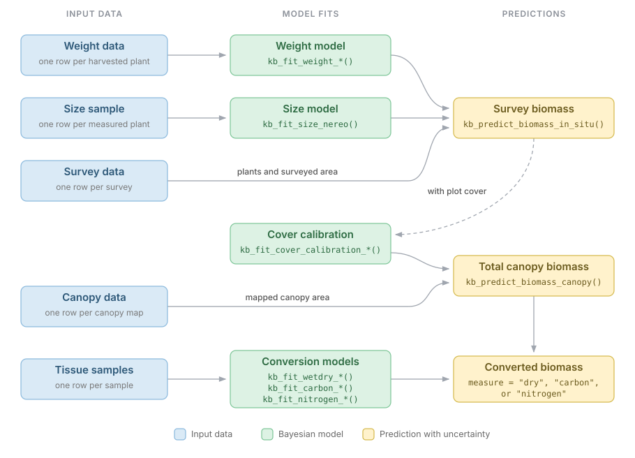

```{r, include = FALSE}
knitr::opts_chunk$set(
  collapse = TRUE,
  comment = "#>",
  fig.width = 7,
  fig.height = 4.5
)
```

```{r setup, message = FALSE, warning = FALSE}
library(kelpbio)
library(ggplot2)
```

kelpbio estimates the biomass of *Nereocystis luetkeana* and *Macrocystis
pyrifera* kelp beds. The total biomass of a site in a given year combines plants
counted and measured from in situ surveys, the surface canopy area mapped from aerial imagery, and a
calibration model that relates the two.

```{r workflow, echo = FALSE, out.width = "100%", fig.alt = "Flow diagram in three columns. Weight, size, and survey data feed the weight and size models and then survey biomass. Survey biomass, with plot cover, fits the cover calibration. The calibration and canopy data give total canopy biomass, which wet/dry, carbon, and nitrogen models, fitted to tissue samples, convert to dry, carbon, or nitrogen biomass."}

```

This article uses *Nereocystis* as an example. The data shown below are simulated, with invented site names.

Two other articles go further:

- [Methods](https://hakaiinstitute.github.io/kelpbio/articles/methods.html)
  describes the models and how predictions are computed.
- [Advanced usage](https://hakaiinstitute.github.io/kelpbio/articles/advanced.html)
  covers priors, diagnostics, and working with other Stan packages.

## Glossary

- **Plant**: one individual (sporophyte), identified by its holdfast (*Macrocystis*) or stipe (*Nereocystis*).
- **In situ survey**: count of the plants within a surveyed area, with all or a sample of the plants measured (e.g., three 30 m sub-surface transects with 2 m swaths, and the maximum sub-bulb diameter measured for about 15 plants per transect).
- **Plot**: area bounding the in situ survey, over which canopy percent cover is estimated.
- **Canopy map**: surface canopy within a site mapped from aerial imagery (e.g., drone), with the tide height at the time of imaging.
- **Site-year**: annual snapshot of a site, i.e., in peak season.

## Data format

Each dataset is a data frame with set column names, one row per measured
unit, and units are part of the column name (for example `diameter_mm`). Other
columns are ignored. Each entry below lists the columns, with example values
from the simulated data included with the package.

```{r data-format, echo = FALSE, results = "asis"}
data_format <- function(title, row, used_by, check, data, columns) {
  example <- vapply(names(columns), function(column) {
    x <- data[[column]]
    x <- x[!is.na(x)][1]
    if (is.double(x)) x <- signif(x, 3)
    as.character(x)
  }, character(1))
  table <- data.frame(
    Column = paste0("<code>", names(columns), "</code>"),
    Example = unname(example),
    Description = unname(columns)
  )
  ref <- function(fun) {
    paste0(
      "<a href=\"https://hakaiinstitute.github.io/kelpbio/reference/", fun,
      ".html\"><code>", fun, "()</code></a>"
    )
  }
  cat(
    "<details>\n<summary><strong>", title, "</strong>, one row per ", row,
    "; used by ", paste(vapply(used_by, ref, ""), collapse = ", "),
    "</summary>\n\n",
    sep = ""
  )
  print(knitr::kable(
    table,
    format = "html",
    escape = FALSE,
    row.names = FALSE,
    table.attr = "class=\"table\""
  ))
  cat("\nChecked by ", ref(check), ".\n\n</details>\n\n", sep = "")
}

data_format(
  "Weight, *Nereocystis*", "harvested plant", "kb_fit_weight_nereo", "kb_check_data_weight_nereo",
  data_weight_sim_nereo,
  c(
    diameter_mm = "Plant diameter (mm), such as the maximum sub-bulb diameter.",
    weight_kg = "Wet weight of the plant (kg).",
    site = "Site.",
    year = "Year."
  )
)
data_format(
  "Weight, *Macrocystis*", "harvested plant", "kb_fit_weight_macro", "kb_check_data_weight_macro",
  data_weight_sim_macro,
  c(
    fronds = "Number of fronds reaching 1 m above the holdfast.",
    weight_kg = "Wet weight of the plant (kg).",
    site = "Site.",
    year = "Year."
  )
)
data_format(
  "Size sample, *Nereocystis*", "measured plant", "kb_fit_size_nereo", "kb_check_data_size_sample_nereo",
  data_size_sample_sim_nereo,
  c(
    diameter_mm = "Plant diameter (mm), the same measure as in the weight data.",
    site = "Site.",
    year = "Year."
  )
)
data_format(
  "In situ survey", "survey", "kb_predict_biomass_in_situ", "kb_check_data_in_situ",
  data_in_situ_sim_nereo,
  c(
    survey_id = "Identifies the survey.",
    site = "Site.",
    year = "Year.",
    survey_area_m2 = "Area surveyed (m²).",
    plants = "Number of plants counted; absent when a size census is given.",
    plot_area_m2 = "Area of the plot (m²); with canopy imagery only.",
    canopy_area_m2 = "Canopy mapped within the plot (m²); with canopy imagery only.",
    canopy_tide_height_m = "Tide height when the canopy was imaged (m); with canopy imagery only."
  )
)
data_format(
  "Size census", "counted plant", "kb_predict_biomass_in_situ", "kb_check_data_size_census_macro",
  data_size_census_sim_macro,
  c(
    survey_id = "The survey the plant was counted in.",
    fronds = "Number of fronds reaching 1 m above the holdfast (*Macrocystis*), or `diameter_mm` (*Nereocystis*).",
    partial = "Optional: `TRUE` for a plant counted as half, such as on the edge of the survey area."
  )
)
data_format(
  "Canopy map", "map of a site's canopy", "kb_predict_biomass_canopy", "kb_check_data_canopy",
  data_canopy_sim_nereo,
  c(
    site = "Site.",
    year = "Year.",
    canopy_area_m2 = "Canopy mapped within the site (m²).",
    canopy_tide_height_m = "Tide height when the canopy was imaged (m).",
    classified_area_m2 = "Water area the imagery classified, with or without canopy (m²)."
  )
)
data_format(
  "Wet/dry", "tissue sample", c("kb_fit_wetdry_nereo", "kb_fit_wetdry_macro"), "kb_check_data_wetdry_nereo",
  data_wetdry_sim_nereo,
  c(
    wet_mass_g = "Mass before drying (g).",
    dry_mass_g = "Mass after drying (g)."
  )
)
data_format(
  "Carbon", "dried tissue sample", c("kb_fit_carbon_nereo", "kb_fit_carbon_macro"), "kb_check_data_carbon_nereo",
  data_carbon_sim_nereo,
  c(
    sample_mass_mg = "Mass of the sample analysed (mg).",
    carbon_mass_ug = "Carbon measured in the sample (µg)."
  )
)
data_format(
  "Nitrogen", "dried tissue sample", c("kb_fit_nitrogen_nereo", "kb_fit_nitrogen_macro"), "kb_check_data_nitrogen_nereo",
  data_nitrogen_sim_nereo,
  c(
    sample_mass_mg = "Mass of the sample analysed (mg).",
    nitrogen_mass_ug = "Nitrogen measured in the sample (µg)."
  )
)
```

Each dataset has a `kb_check_data_*()` function that checks the data against the format expected by the model fitting functions (e.g., column names and values) and gives an informative error message when a correction is required.
See `?kb_check_data_*` for details on the format requirements.

```{r, error = TRUE}
kb_check_data_weight_nereo(data_weight_sim_nereo)

kb_check_data_weight_nereo(data_weight_sim_nereo[, c("diameter_mm", "site")])
```

## Fit a model

The weight model relates plant weight to diameter, allowing for differences
among sites and years.

```{r, eval = FALSE}
fit <- kb_fit_weight_nereo(data_weight_sim_nereo)
```

```{r, include = FALSE}
fit <- fit_weight_sim_nereo
```

`tidy()` or `coef()` gives the estimate of each parameter with its lower and upper 95%
compatibility limits.

```{r}
tidy(fit)
```

Model convergence can be checked with `glance()` or `kb_converged()`.
A converged model must meet thresholds for R-hat, effective sample size (ESS), and divergent transitions. See `?kb_converged` for definitions and suggestions for resolving convergence failures.

```{r}
glance(fit)
```

In a converged model, the chains of each parameter overlap and should resemble a 'fuzzy caterpillar'.

```{r, fig.height = 6}
kb_plot_trace(fit)
```

## Predict and plot

The `kb_predict_*()` functions take a fit object and generate predictions (estimates with 95% compatibility limits).

If no new data are supplied, predictions are made for each row of the data the model was fitted to.

```{r}
kb_predict_weight(fit)
```

New data can be supplied to predict at specific values.

```{r}
new_dat <- data.frame(site = "otter_cove", year = 2023, diameter_mm = c(15, 20))
kb_predict_weight(fit, new_data = new_dat)
```

`kb_new_data()` generates a grid of new data, e.g., the full range of diameters at each site, and the predictions can be plotted with `kb_plot_predictions()`.

```{r}
predictions <- kb_predict_weight(fit, kb_new_data(fit, by = "site"))
kb_plot_predictions(predictions)
```

The plot is a ggplot object, so the data can be added as a layer.

```{r}
kb_plot_predictions(predictions, log_axis = "xy") +
  geom_point(
    data = data_weight_sim_nereo,
    aes(x = diameter_mm, y = weight_kg),
    alpha = 0.3,
    inherit.aes = FALSE
  )
```

See the [advanced usage article](https://hakaiinstitute.github.io/kelpbio/articles/advanced.html) for control over how uncertainty is estimated for a new site or year, that is, one not in the data the model was fitted to.

## From plants to site biomass

### In situ biomass

The biomass of a survey is its number of plants times their mean weight, over
the area surveyed. Mean weight is estimated, with uncertainty, from the weight model and a size model
fitted to a sample of measured plants.

```{r, eval = FALSE}
fit_size <- kb_fit_size_nereo(data_size_sample_sim_nereo)
```

```{r}
data_in_situ_sim_nereo

set.seed(1)
biomass <- kb_predict_biomass_in_situ(
  fit_weight_sim_nereo,
  fit_size_sim_nereo,
  data_in_situ_sim_nereo,
  progress = "none"
)
biomass
```


### Cover calibration

The cover calibration model relates the estimated biomass of each in situ survey to the percent cover of canopy mapped (e.g., by drone or satellite imagery) within the plot bounding the survey.

```{r, eval = FALSE}
fit_cover <- kb_fit_cover_calibration_nereo(biomass)
```

```{r}
fit_cover <- fit_cover_calibration_sim_nereo

kb_predict_cover_calibration(fit_cover, kb_new_data(fit_cover)) |>
  kb_plot_predictions()
```

### Total biomass

The cover calibration model is applied to the mapped canopy of each site-year to estimate its total biomass.

```{r, fig.width = 9, fig.height = 5.5}
data_canopy_sim_nereo

totals <- kb_predict_biomass_canopy(fit_cover, data_canopy_sim_nereo)
totals

kb_plot_predictions(totals, geom = "bar")
```

`pool_by` pools the estimates by group, in this case to give the total biomass in each year, summed across sites, with the uncertainty of the sum.

```{r, fig.width = 9, fig.height = 5.5}
set.seed(1)
kb_predict_biomass_canopy(fit_cover, data_canopy_sim_nereo, pool_by = "year") |>
  kb_plot_predictions(geom = "bar")
```

See the [methods article](https://hakaiinstitute.github.io/kelpbio/articles/methods.html#survey-design) for more detail, including a diagram of a typical survey layout that shows how a plot relates to its site.

### Dry and carbon biomass

A wet/dry model fit converts wet to dry biomass, a carbon model fit converts dry
biomass to carbon, and a nitrogen model fit converts dry biomass to nitrogen.

```{r}
kb_predict_biomass_canopy(
  fit_cover,
  data_canopy_sim_nereo,
  wetdry = fit_wetdry_sim_nereo,
  carbon = fit_carbon_sim_nereo,
  measure = "carbon"
)
```

## Pre-fit models

The kelpbiodata package holds Hakai Institute and coastwide datasets, with models pre-fit to them. The pre-fit models can be used when data have not been collected for a particular sub-model, such as harvested plants for weight allometry or tissue samples for the dry:wet ratio and carbon fraction.

```{r, eval = rlang::is_installed("kelpbiodata")}
set.seed(1)
kb_predict_biomass_in_situ(
  kelpbiodata::fit_weight_coastwide_nereo,
  kelpbiodata::fit_size_hakai_nereo,
  data_in_situ_sim_nereo[1:3, ],
  progress = "none"
)
```

Sites or years in the user's data that are not in the pre-fit model's dataset are treated as new levels, so their estimates have wider uncertainty.

User data can also be combined with a kelpbiodata dataset to increase the number of observations. For example, if plants have been harvested at only a couple of sites, combining them with the kelpbiodata weights gives a better estimate of the general weight allometry relationship, while the site-level random effect still gives an estimate for each site of interest.

```{r, eval = rlang::is_installed("kelpbiodata")}
data_weight <- dplyr::bind_rows(
  kelpbiodata::data_weight_hakai_nereo,
  dplyr::filter(data_weight_sim_nereo, site %in% c("otter_cove", "gull_rock"))
)

# 3 chains of 500 draws match the 1500 draws of fit_size_sim_nereo.
fit_combined <- kb_fit_weight_nereo(
  data_weight,
  chains = 3L,
  niters = 500L,
  nthin = 4L,
  seed = 1L,
  progress = "none",
  control = list(adapt_delta = 0.99)
)

set.seed(1)
kb_predict_biomass_in_situ(
  fit_combined,
  fit_size_sim_nereo,
  data_in_situ_sim_nereo[1:3, ],
  progress = "none"
)
```


## Censused areas

If every plant within a survey area is counted and measured (a full census), a size model is not needed, and `per_area = FALSE` gives the total biomass in the surveyed area. In this case no calibration is needed, and the uncertainty in biomass comes only from the weight model.

```{r}
data_size_census_sim_nereo

# The censused surveys, with their counts taken from the census.
census_surveys <- dplyr::filter(
  data_in_situ_sim_nereo,
  survey_id %in% data_size_census_sim_nereo$survey_id
)
census_surveys <- dplyr::select(census_surveys, -plants)

kb_predict_biomass_in_situ(
  fit_weight_sim_nereo,
  data_size_census_sim_nereo,
  census_surveys,
  per_area = FALSE,
  progress = "none"
)
```

## *Macrocystis*

Every counted *Macrocystis* plant has its fronds recorded, so a size census is
always used in place of a size model. The calibration and totals follow as for
*Nereocystis*.

```{r}
biomass_macro <- kb_predict_biomass_in_situ(
  fit_weight_sim_macro,
  data_size_census_sim_macro,
  data_in_situ_sim_macro
)
```
