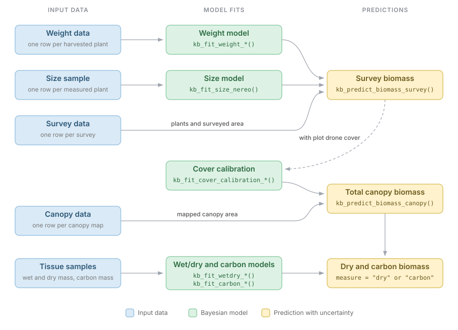

```{r, include = FALSE}
knitr::opts_chunk$set(
  collapse = TRUE,
  comment = "#>"
)
```

```{r setup, message = FALSE, warning = FALSE}
library(kelpbio)
```

kelpbio estimates the total biomass of a kelp bed in each site and year from
three sources: the canopy area mapped by drone, the biomass counted by in situ
surveys of plots, and a calibration model that relates the two. Models are
available for *Nereocystis luetkeana* and *Macrocystis pyrifera*.

```{r workflow, echo = FALSE, out.width = "100%", fig.alt = "Flow diagram in three columns. Weight, size, and survey data feed the weight and size models and then survey biomass. Survey biomass, with plot drone cover, fits the cover calibration. The calibration and canopy data give total canopy biomass, which wet/dry and carbon models, fitted to tissue samples, convert to dry and carbon biomass."}

```

Each prediction is computed from the posterior draws of every model that feeds
it, so its uncertainty carries through to the totals.

## Terms

- **Plant**: one individual (sporophyte), identified by its holdfast. "Plant" is
  used for convenience, as in Reed et al. (2009).
- **Plot**: a fixed area at a site, identified by `plot_id`. Drone canopy within
  the plot is measured over its polygon (`plot_area_m2`).
- **Survey**: one in situ count of a plot on a `date`, over the area searched
  (`survey_area_m2`), for example a dive's transects. The area searched may be
  smaller than the plot.

Estimates are for the peak season, at site-year resolution:

- A site-year may hold several plots, and a plot several surveys.
- Each survey is one row. Surveys with drone cover each enter the calibration as
  one observation, sharing their site and year effects.

## Inputs

| Data | One row per | Keyed by | Fitted by or passed to |
|---|---|---|---|
| Weight | harvested plant | `site`, `date` | `kb_fit_weight_nereo()`, `kb_fit_weight_macro()` |
| Size (*Nereocystis*) | measured plant | `site`, `date` (`plot_id` optional) | `kb_fit_size_nereo()` |
| Survey | survey of a plot | `site`, `plot_id`, `date` | `kb_predict_biomass_survey()` |
| Plants (census) | counted plant | `site`, `plot_id`, `date` | `kb_predict_biomass_survey()` |
| Canopy | mapped site-year | `site`, `year` | `kb_predict_biomass_canopy()` |

Field data are dated: `date` is a `Date`, and the year is taken from it. The
models work at site-year resolution, so predictions and totals are by site and
year.

Plant sizes come from one of two sources:

- **Tallied plants** (*Nereocystis*): the survey records the number of `plants`,
  and a size fit models their size distribution from a measured sample.
- **Counted plants** (*Macrocystis*, or any full census): a plants table holds
  the size of every counted plant, joined to its survey by `site`, `plot_id`, and
  `date`. A survey with no plant rows has no biomass.

```{r}
data_survey_sim_nereo
```

## Workflow

The weight and size models are fitted first. The bundled pre-fits stand in for
them here.

```{r, eval = FALSE}
fit_weight <- kb_fit_weight_nereo(data_weight_sim_nereo)
fit_size <- kb_fit_size_nereo(data_size_sim_nereo)
```

Survey biomass is the expected weight of each survey's plants per m² of the area
searched.

Sites and years without weight or size data take a sampled effect, so a seed
makes the results reproducible.

```{r}
set.seed(1)
biomass <- kb_predict_biomass_survey(
  fit_weight_sim_nereo,
  fit_size_sim_nereo,
  data_survey_sim_nereo
)
biomass
```

```{r}
biomass_site_year <- kb_predict_biomass_survey(
  fit_weight_sim_nereo,
  fit_size_sim_nereo,
  data_survey_sim_nereo,
  pool_by = c("site", "year")
)
kb_plot_predictions(biomass_site_year)
```

The calibration relates survey biomass to the tide-corrected drone cover of each
survey's plot.

```{r, eval = FALSE}
fit_cover <- kb_fit_cover_calibration_nereo(biomass)
```

```{r}
fit_cover <- fit_cover_calibration_sim_nereo
kb_predict_cover_calibration(fit_cover, kb_new_data(fit_cover)) |>
  kb_plot_predictions()
```

Total biomass is the calibration applied over each site-year's mapped canopy.

```{r}
totals <- kb_predict_biomass_canopy(fit_cover, data_canopy_sim_nereo)
totals
kb_plot_predictions(totals)
```

Totals sum over any grouping column, draw by draw:

```{r}
kb_predict_biomass_canopy(fit_cover, data_canopy_sim_nereo, pool_by = "year")
```

Dry and carbon biomass take a wet/dry fit, and for carbon also a carbon fit:

```{r}
kb_predict_biomass_canopy(
  fit_cover,
  data_canopy_sim_nereo,
  wetdry = fit_wetdry_sim_nereo,
  carbon = fit_carbon_sim_nereo,
  measure = "carbon"
)
```

### *Macrocystis*

Every counted *Macrocystis* plant has its fronds at 1 m recorded, so a plants
table takes the place of a size fit.

```{r}
biomass_macro <- kb_predict_biomass_survey(
  fit_weight_sim_macro,
  data_plants_sim_macro,
  data_survey_sim_macro
)
```

The calibration and totals then follow as for *Nereocystis*.

## Other uses

- **Plant weights**: `kb_predict_weight()` gives the expected weight of plants of
  given sizes.
- **Size distributions**: `kb_predict_size()` and `posterior_predict()` on a size
  fit describe *Nereocystis* size by site and year.
- **Mean plant weight**: `kb_predict_mean_weight()` combines the weight and size
  fits per site-year.
- **Censused sites**: where every plant in a site is counted and measured,
  `kb_predict_biomass_survey(per_area = FALSE)` gives its total biomass with no
  drone calibration.
- **Other size measures**: the *Nereocystis* weight and size models accept any
  plant diameter in `diameter_mm`, such as bulb diameter or sub-bulb diameter
  15 cm below the bulb, provided that:
  - the weight and size data use the same measurement;
  - the power law (`form = "power"`) or Packard power law (`form =
    "packard_floor"`) fits the data, as `pp_check()` and `loo()` show.

## Next steps

`vignette("advanced")` covers working with the posterior draws directly,
prediction grids and new sites, priors and prior checks, fit diagnostics, and
sampler control.

## References

Reed, D. C., Rassweiler, A. R., and Arkema, K. K. 2009. Density derived
estimates of standing crop and net primary production in the giant kelp
*Macrocystis pyrifera*. Marine Biology 156: 2077-2083.
<https://doi.org/10.1007/s00227-009-1238-6>
